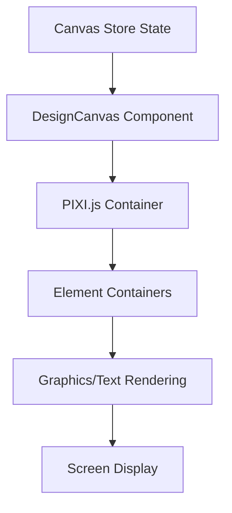

# State Elements, Rendering, and Z-Index Documentation

## Overview

This document explains how canvas elements are managed in state, how they're rendered to the screen, what triggers re-renders, and how z-index layering works in the PIXI.js-based canvas system.

## Table of Contents

1. [State Management](#state-management)
2. [Element Rendering Pipeline](#element-rendering-pipeline)
3. [Re-render Triggers](#re-render-triggers)
4. [Z-Index System](#z-index-system)
5. [Performance Considerations](#performance-considerations)
6. [Common Patterns](#common-patterns)

## State Management

### Canvas Store Structure

The canvas state is managed through Zustand stores with the following structure:

```typescript
interface CanvasState {
  // Core state
  elements: AnimatedCanvasObject[];
  groups: CanvasGroup[];
  
  // Loading and optimistic update state
  isLoading: boolean;
  pendingOperations: Set<string>;
  
  // History for undo/redo
  history: {
    past: Array<{ elements: AnimatedCanvasObject[]; groups: CanvasGroup[] }>;
    future: Array<{ elements: AnimatedCanvasObject[]; groups: CanvasGroup[] }>;
  };
}
```

### Element Data Structure

```typescript
interface AnimatedCanvasObject {
  id: string;
  name: string;
  type: ShapeType; // 'rectangle', 'circle', 'text', 'line', 'path', 'image'
  x: number;
  y: number;
  width: number;
  height: number;
  rotation: number;
  fill: string;
  stroke: string;
  strokeWidth: number;
  visible: boolean;
  zIndex: number; // Controls layering order
  groupId?: string; // Optional group association
  animations: ElementAnimation[];
  // ... other properties based on type
}
```

### State Operations

The canvas store provides operations for managing elements:

```typescript
// Element operations
addElement: (element: AnimatedCanvasObject) => void;
updateElement: (id: string, updates: Partial<AnimatedCanvasObject>) => void;
removeElement: (id: string) => void;
duplicateElement: (id: string) => void;

// Z-index operations
bringElementToFront: (id: string) => void;
sendElementToBack: (id: string) => void;
bringGroupToFront: (id: string) => void;
sendGroupToBack: (id: string) => void;

// Bulk operations
updateMultipleElements: (updates: Array<{ id: string; updates: Partial<AnimatedCanvasObject> }>) => void;
moveMultipleElements: (movements: Array<{ id: string; x: number; y: number }>) => void;
```

## Element Rendering Pipeline

### 1. State to Component Flow



### 2. Rendering Process

The `DesignCanvas` component receives state and renders elements:

```typescript
export const DesignCanvas = (props: DesignCanvasProps) => {
  const {
    elements,        // From store
    groups,          // From store
    selectedIds,     // From selection store
    hoveredId,       // From UI store
    // ... other props
  } = props;

  return (
    <pixiContainer
      sortableChildren={true}  // Enable PIXI.js z-index sorting
      // ... other props
    >
      {/* Render grouped elements */}
      {groups.filter(group => !group.isDefaultGroup).map((group) => {
        const groupElements = elements.filter(el => el.groupId === group.id);
        return (
          <pixiContainer zIndex={Math.max(...groupElements.map(el => el.zIndex || 0))}>
            {groupElements.map((el) => (
              <pixiContainer zIndex={el.zIndex || 0}>
                <pixiGraphics draw={(g) => drawShape(g, el)} />
                {/* Text rendering for text elements */}
                {el.type === 'text' && <RichTextRenderer element={el} />}
              </pixiContainer>
            ))}
          </pixiContainer>
        );
      })}

      {/* Render ungrouped elements */}
      {elements.filter(el => !el.groupId || isDefaultGroup(el.groupId)).map((el) => (
        <pixiContainer zIndex={el.zIndex || 0}>
          <pixiGraphics draw={(g) => drawShape(g, el)} />
          {/* Text rendering for text elements */}
          {el.type === 'text' && <RichTextRenderer element={el} />}
        </pixiContainer>
      ))}
    </pixiContainer>
  );
};
```

### 3. Shape Drawing

Elements are drawn using the `drawShape` utility:

```typescript
const drawShape = (g: Graphics, element: AnimatedCanvasObject) => {
  g.clear();
  
  switch (element.type) {
    case 'rectangle':
      g.rect(0, 0, element.width, element.height);
      g.fill({ color: parseColor(element.fill) });
      if (element.stroke) {
        g.stroke({ color: parseColor(element.stroke), width: element.strokeWidth });
      }
      break;
    case 'circle':
      g.circle(element.width / 2, element.height / 2, element.width / 2);
      g.fill({ color: parseColor(element.fill) });
      break;
    // ... other shape types
  }
};
```

## Re-render Triggers

### 1. State Changes

Elements re-render when their state changes:

```typescript
// These operations trigger re-renders
updateElement(id, { x: 100, y: 200 });           // Position change
updateElement(id, { fill: '#ff0000' });          // Color change
updateElement(id, { width: 150, height: 100 });  // Size change
updateElement(id, { rotation: 45 });             // Rotation change
updateElement(id, { zIndex: 10 });               // Z-index change
```

### 2. Selection Changes

Selection state changes trigger re-renders for selection indicators:

```typescript
// Selection store changes
const { select, deselect, clearSelection } = useSelectionStore();

// These trigger re-renders of selection handles
select('element-id');
deselect('element-id');
clearSelection();
```

### 3. Hover State Changes

Hover state changes trigger re-renders for hover outlines:

```typescript
// UI store hover changes
const { setHoveredId } = useUIStore();

// These trigger re-renders of hover outlines
setHoveredId('element-id');
setHoveredId(null);
```

### 4. Animation State Changes

Animation playback state affects rendering:

```typescript
// Timeline store changes
const { isPlaying } = useTimelineStore();

// When animations are playing, selection handles are hidden
{!isPlaying && selectedIds.length === 1 && (
  <ResizeHandles element={selectedElement} />
)}
```

### 5. Tool State Changes

Tool changes affect element interactivity:

```typescript
// Tool state affects event handling
const tool = useUIStore(state => state.tool);

// Elements are only interactive in select/draw tools
interactive={tool === 'select' || tool === 'draw'}
eventMode={tool === 'select' || tool === 'draw' ? 'dynamic' : 'none'}
```

## Z-Index System

### 1. PIXI.js Native Z-Index

The system uses PIXI.js native z-index sorting:

```typescript
// Main container enables z-index sorting
<pixiContainer sortableChildren={true}>
  {/* All children are sorted by zIndex automatically */}
</pixiContainer>
```

### 2. Z-Index Ranges

```typescript
// Z-index ranges for different element types
const Z_INDEX_RANGES = {
  CANVAS_ELEMENTS: { min: 0, max: 999 },      // Shapes, text, images
  DRAWING_LAYERS: { min: 1000, max: 1999 },   // Drawing preview, line preview
  SELECTION_UI: { min: 2000, max: 2999 },     // Resize handles, rotation handles
  SNAP_GUIDES: { min: 3000, max: 3999 },      // Snap guides, grid
};
```

### 3. Z-Index Operations

```typescript
// Bring element to front
bringElementToFront: (id: string) => {
  set(produce((state) => {
    const element = state.elements.find(el => el.id === id);
    if (element) {
      const maxZIndex = Math.max(...state.elements.map(el => el.zIndex || 0));
      element.zIndex = maxZIndex + 1;
    }
  }));
};

// Send element to back
sendElementToBack: (id: string) => {
  set(produce((state) => {
    const element = state.elements.find(el => el.id === id);
    if (element) {
      const minZIndex = Math.min(...state.elements.map(el => el.zIndex || 0));
      element.zIndex = minZIndex - 1;
    }
  }));
};
```

### 4. Group Z-Index

Groups maintain their own z-index based on their children:

```typescript
// Group container z-index is the maximum of its children
<pixiContainer zIndex={Math.max(...groupElements.map(el => el.zIndex || 0))}>
  {groupElements.map((el) => (
    <pixiContainer zIndex={el.zIndex || 0}>
      {/* Element content */}
    </pixiContainer>
  ))}
</pixiContainer>
```

### 5. Z-Index Assignment

New elements get z-index values that place them on top:

```typescript
// In canvas-object-factory.ts
function generateCommonAttributes(type: ShapeType, { x, y, elements }: BaseObjectProps) {
  const maxZIndex = elements.length > 0 ? Math.max(...elements.map(el => el.zIndex || 0)) : 0;
  const defaultZIndex = maxZIndex + 1;
  
  return {
    // ... other attributes
    zIndex: defaultZIndex, // New elements appear on top
  };
}
```

## Performance Considerations

### 1. Selective Re-rendering

React components use selective subscriptions to minimize re-renders:

```typescript
// Only subscribe to specific state slices
const elements = useCanvasStore(state => state.elements);
const selectedIds = useSelectionStore(state => state.selectedIds);
const hoveredId = useUIStore(state => state.hoveredId);
```

### 2. Memoization

Expensive operations are memoized:

```typescript
// Memoize filtered elements
const groupedElements = useMemo(() => 
  elements.filter(el => el.groupId === groupId), 
  [elements, groupId]
);

// Memoize sorted elements
const sortedElements = useMemo(() => 
  elements.sort((a, b) => (a.zIndex || 0) - (b.zIndex || 0)), 
  [elements]
);
```

### 3. PIXI.js Optimization

PIXI.js handles efficient rendering:

- **GPU Acceleration**: All rendering happens on the GPU
- **Batch Rendering**: Similar elements are batched together
- **Culling**: Off-screen elements are not rendered
- **Z-Index Sorting**: Efficient internal sorting by PIXI.js

### 4. Event Handling Optimization

Event handlers are optimized to prevent unnecessary updates:

```typescript
// Debounced updates for dragging
const debouncedUpdate = useMemo(
  () => debounce((updates) => updateMultipleElements(updates), 16),
  [updateMultipleElements]
);
```

## Common Patterns

### 1. Element Creation

```typescript
// Create a new element
const newElement = createCanvasObject('rectangle', { x: 100, y: 100 });
addElement(newElement);

// Element automatically gets appropriate z-index and group
```

### 2. Element Updates

```typescript
// Update element properties
updateElement(elementId, {
  x: newX,
  y: newY,
  fill: newColor,
  zIndex: newZIndex
});

// Multiple elements at once
updateMultipleElements([
  { id: 'element1', updates: { x: 100, y: 200 } },
  { id: 'element2', updates: { fill: '#ff0000' } }
]);
```

### 3. Z-Index Management

```typescript
// Bring element to front
bringElementToFront('element-id');

// Send element to back
sendElementToBack('element-id');

// Custom z-index assignment
updateElement('element-id', { zIndex: 50 });
```

### 4. Group Operations

```typescript
// Create group from elements
const group = createGroupFromElements(['element1', 'element2']);

// Bring entire group to front
bringGroupToFront(group.id);

// Ungroup elements
ungroupElements(group.id);
```

### 5. Selection Management

```typescript
// Select single element
select('element-id');

// Multi-select
select('element-id', true); // isMultiSelect = true

// Clear selection
clearSelection();
```

## Debugging Tips

### 1. State Inspection

```typescript
// Log current state
console.log('Elements:', useCanvasStore.getState().elements);
console.log('Selected:', useSelectionStore.getState().selectedIds);
console.log('Hovered:', useUIStore.getState().hoveredId);
```

### 2. Z-Index Debugging

```typescript
// Log z-index values
elements.forEach(el => {
  console.log(`${el.name}: zIndex = ${el.zIndex}`);
});
```

### 3. Performance Monitoring

```typescript
// Monitor re-render frequency
const renderCount = useRef(0);
useEffect(() => {
  renderCount.current += 1;
  console.log(`DesignCanvas rendered ${renderCount.current} times`);
});
```

This documentation provides a comprehensive understanding of how state elements work, how they're rendered, what triggers updates, and how the z-index system operates in the canvas application. 