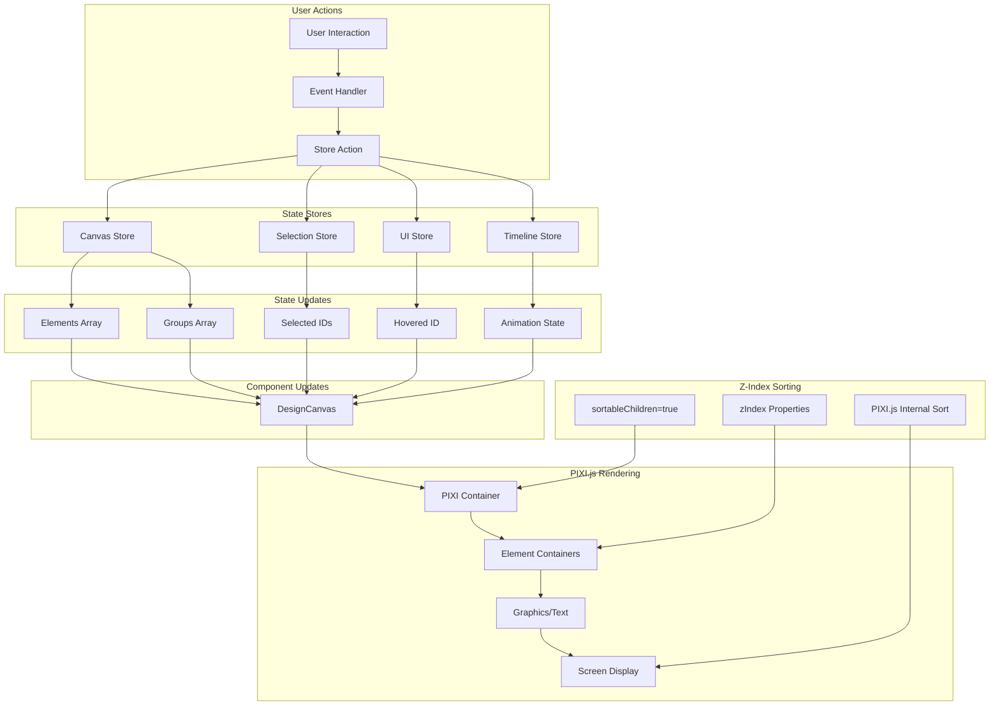
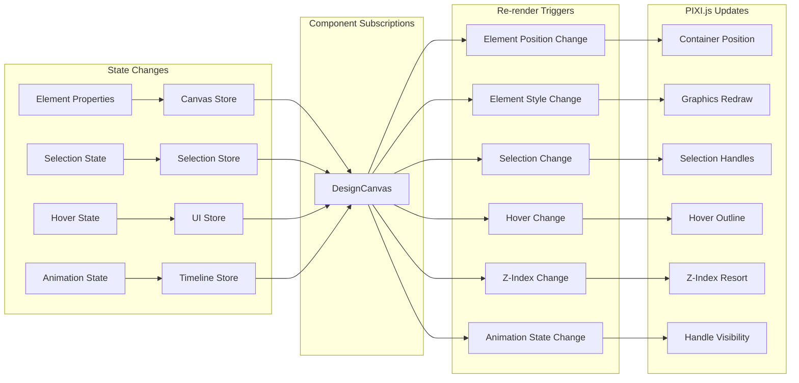
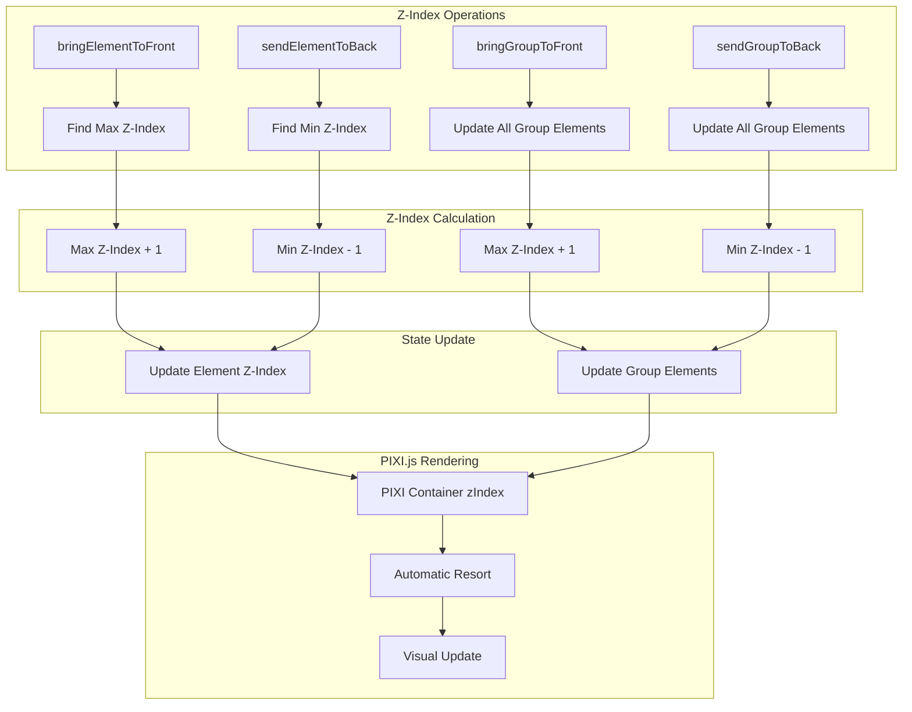
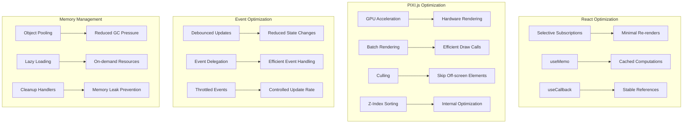
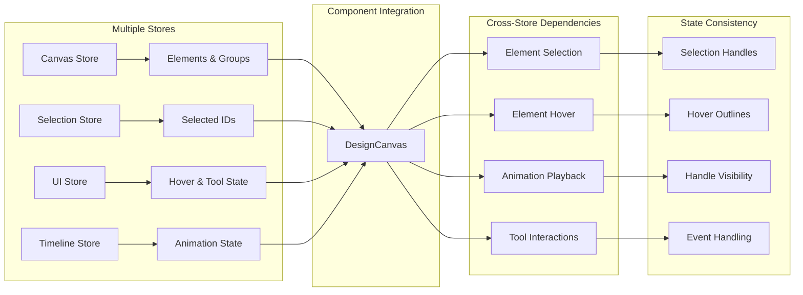
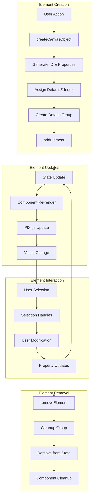

# State Flow and Rendering Pipeline Diagram

## State Management Flow



## Element Rendering Hierarchy

```mermaid
graph TD
    subgraph "Main Canvas Container"
        A[pixiContainer<br/>sortableChildren=true<br/>zIndex: N/A]
    end
    
    subgraph "Canvas Elements (zIndex: 0-999)"
        B[Group Container<br/>zIndex: max(child zIndex)]
        C[Element Container<br/>zIndex: element.zIndex]
        D[Element Container<br/>zIndex: element.zIndex]
        E[Element Container<br/>zIndex: element.zIndex]
    end
    
    subgraph "Drawing Layers (zIndex: 1000-1999)"
        F[Drawing Preview<br/>zIndex: 1000]
        G[Line Preview<br/>zIndex: 1001]
    end
    
    subgraph "Selection UI (zIndex: 2000-2999)"
        H[Resize Handles<br/>zIndex: 2000]
        I[Radius Handles<br/>zIndex: 2001]
        J[Group Selection<br/>zIndex: 2002]
        K[Rotation Handles<br/>zIndex: 2003]
    end
    
    subgraph "Snap Guides (zIndex: 3000+)"
        L[Snap Guides<br/>zIndex: 3000]
    end
    
    A --> B
    A --> C
    A --> D
    A --> E
    A --> F
    A --> G
    A --> H
    A --> I
    A --> J
    A --> K
    A --> L
    
    B --> C
    B --> D
```

## Re-render Trigger Flow



## Z-Index Management Flow



## Performance Optimization Flow



## State Synchronization Flow



## Element Lifecycle Flow



These diagrams provide a visual understanding of how state flows through the system, how elements are rendered, and how the z-index system operates in the canvas application. 